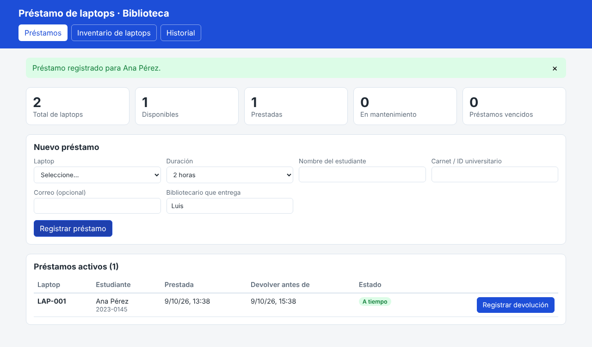

# Préstamos y reservas · Biblioteca universitaria

Aplicación web con dos módulos que funcionan igual:

- **Laptops**: préstamo de las laptops 1 a 25.
- **Cubículos**: reserva de los cubículos 1 a 6 y el POD.

Cada módulo tiene su formulario, la lista de préstamos o reservas en curso (con alerta de
vencidos), el estado de cada laptop o cubículo y el historial.



Hecha con **React + TypeScript + Vite**. Los datos se guardan en una base de datos en línea
(**Supabase**, gratuita) o, si no se configura, en el navegador (localStorage).

## Cómo usarla

Requiere [Node.js](https://nodejs.org) 20 o superior.

```bash
npm install
npm run dev      # abre http://localhost:5173
npm run build    # genera la versión final en dist/
```

## Verla en línea

La app se publica sola en GitHub Pages cada vez que se actualiza la rama `main`:
https://michaelzzve-tech.github.io/crai/

Con Supabase configurado, todos los bibliotecarios ven los mismos datos después de iniciar sesión.
Sin Supabase, cada persona que la abre tiene sus propios datos, guardados en su navegador.

## Base de datos (Supabase)

1. Cree una cuenta gratis en https://supabase.com y un proyecto nuevo.
2. En el proyecto, abra **SQL Editor → New query**, pegue el contenido de
   [`supabase/esquema.sql`](supabase/esquema.sql) y pulse **Run**. Esto crea las tablas.
   Si ya había creado las tablas antes del cambio de devolución automática, en vez de
   eso basta con ejecutar esta línea (no borra datos):
   `alter table prestamos alter column hora_fin drop not null;`
   Y para el campo Género (tampoco borra datos):
   `alter table prestamos add column if not exists genero text; alter table reservas add column if not exists genero text;`
3. En **Authentication → Users → Add user → Create new user**, cree una cuenta (correo y
   contraseña) para cada bibliotecario. Marque "Auto Confirm User".
4. En **Authentication → Sign In / Providers**, desactive **Allow new users to sign up**
   para que nadie más pueda crearse una cuenta.
5. En **Project Settings → API** copie el **Project URL** y la clave **anon public**.
6. En GitHub, en el repositorio, abra **Settings → Secrets and variables → Actions →
   New repository secret** y cree dos secretos con esos valores:
   `VITE_SUPABASE_URL` y `VITE_SUPABASE_ANON_KEY`.
7. Vuelva a publicar la web: **Actions → Publicar en GitHub Pages → Run workflow**.

Para usar la base de datos en su computadora, copie `.env.example` como `.env.local`
y pegue los mismos dos valores.

## Funciones

- **Formulario**, en este orden: nombre, género (masculino, femenino), instituto (ITJO, IUJO, CFJO),
  condición (estudiante, docente, otro), carrera o año (ITJO: año del 1 al 6; IUJO: carrera;
  CFJO: un número escrito a mano), laptop (1 a 25) o cubículo (1 a 6 o POD), motivo de uso
  (estudio, tarea, entretenimiento) y hora de inicio. Los cubículos piden además hora de fin
  y muestran la duración (se calcula sola).
- **En curso**: préstamos o reservas activos; desde ahí se registra la devolución de la
  laptop o la salida del cubículo. En las laptops, la hora de devolución
  se toma sola en el momento y se muestra el **tiempo transcurrido** desde la hora de inicio.
- **Centro de notificaciones** (campana del encabezado): avisa cuando a una reserva de
  cubículo le faltan 10 minutos o menos para su hora de fin, y cuando ya se venció. Los
  avisos nuevos aparecen destacados en la esquina inferior (en rojo los vencidos) y la fila
  se marca en amarillo (por vencer) o en rojo (vencida). Desde la campana se pueden activar
  los avisos del sistema para verlos aunque la página esté en segundo plano. Los minutos se
  cambian en `MINUTOS_AVISO` (`src/services/registroService.ts`).
- **Informes** (ícono de gráfica en el extremo derecho del encabezado): totales de un rango de fechas (por defecto, el mes actual): préstamos de
  laptops, horas de uso de laptops (de la hora de inicio a la devolución), reservas de
  cubículos y horas reservadas de cubículos, con el desglose de cada uno por instituto,
  género, condición, carrera o año y motivo de uso. El botón **Descargar PDF** guarda el informe.
- **Respaldo**: en Informes, el botón **Descargar respaldo (Excel)** guarda un archivo con
  los préstamos y las reservas (una hoja para cada uno): todos, los de un año o los de un mes
  (se cuentan por la fecha de inicio, en hora de Caracas).
- **Borrar todos los registros**: al final de Informes. Deja en 0 préstamos y reservas (y libera
  laptops y cubículos en uso). Pide la contraseña del usuario para confirmar (sin base de datos,
  escribir BORRAR) y ofrece descargar el respaldo antes. No se puede deshacer.
- **Páginas de 30**: cada tabla muestra como máximo 30 registros; si hay más, aparecen flechas
  (« ‹ › ») para pasar de página. El número se cambia en `REGISTROS_POR_PAGINA`
  (`src/hooks/usePaginacion.ts`).
- **Hora de Caracas**: todas las horas se muestran y se registran en hora de Caracas,
  Venezuela, aunque la computadora tenga otra zona horaria.
- **Laptops / Cubículos**: estado de cada uno y opción de enviarlo a mantenimiento.
- **Historial**: todos los registros, con búsqueda y marca de los que terminaron con retraso.
- **Resumen**: disponibles, en uso, en mantenimiento y (en cubículos) reservas vencidas.

Reglas incluidas: solo se usan laptops o cubículos disponibles (los ocupados o en
mantenimiento aparecen desactivados en el menú) y, en los cubículos, la hora de fin debe ser posterior a la de inicio.

## Estructura (por componentes)

```
src/
├── config/
│   ├── modulos.ts        Módulos (laptops, cubículos): cantidad, tablas y textos
│   └── opciones.ts       Opciones de los menús desplegables
├── types/            Tipos de datos (Recurso, Registro…)
├── data/             Acceso a datos
│   ├── repository.ts             Interfaz `Repositorio`
│   ├── supabaseRepository.ts     Implementación con Supabase
│   ├── localStorageRepository.ts Implementación en el navegador
│   └── index.ts                  Aquí se elige qué implementación usar
├── services/
│   └── registroService.ts        Reglas del negocio (registrar, finalizar, validar)
├── hooks/
│   ├── useBiblioteca.ts          Carga y refresca los datos
│   └── useSesion.ts              Inicio de sesión de bibliotecarios
├── utils/            Fechas e IDs
├── components/       Una carpeta por componente
│   ├── Encabezado/        Título, módulos, pestañas y cerrar sesión
│   ├── Login/             Pantalla de inicio de sesión
│   ├── Resumen/           Tarjetas con totales
│   ├── EstadoBadge/       Etiqueta de color para estados
│   ├── RecursoList/       Estado de las laptops o cubículos
│   ├── RegistroForm/      Formulario de préstamo o reserva
│   ├── RegistrosActivos/  Registros en curso y devolución o salida
│   └── Historial/         Historial de préstamos o reservas
├── styles/global.css  Estilos y colores (variables al inicio)
└── App.tsx            Une los componentes
```

## Cambios comunes

| Quiero… | Archivo |
|---|---|
| Cambiar las opciones de un menú (institutos, carreras, años, motivos…) | `src/config/opciones.ts` |
| Cambiar las laptops o cubículos del menú (cantidad, o nombres como POD) | `opciones` en `src/config/modulos.ts` |
| Agregar otro módulo (por ejemplo, salas) | una entrada en `src/config/modulos.ts` y sus tablas en `supabase/esquema.sql` |
| Cambiar o agregar reglas | `src/services/registroService.ts` |
| Agregar un campo al formulario | `src/types/index.ts`, `src/components/RegistroForm/RegistroForm.tsx` y la base de datos |
| Cambiar colores | variables al inicio de `src/styles/global.css` |
| Cambiar las tablas de la base de datos | `supabase/esquema.sql` y `src/data/supabaseRepository.ts` |
| Usar otra base de datos | crear una clase que implemente `Repositorio` y usarla en `src/data/index.ts` |

> Sin Supabase los datos viven solo en ese navegador y esa computadora.
